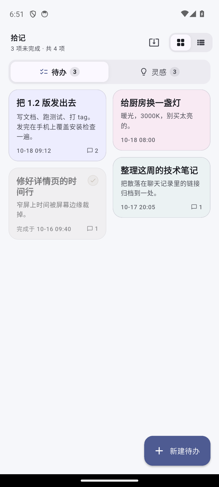
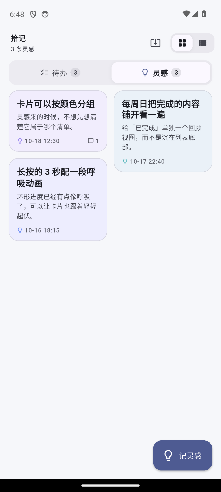
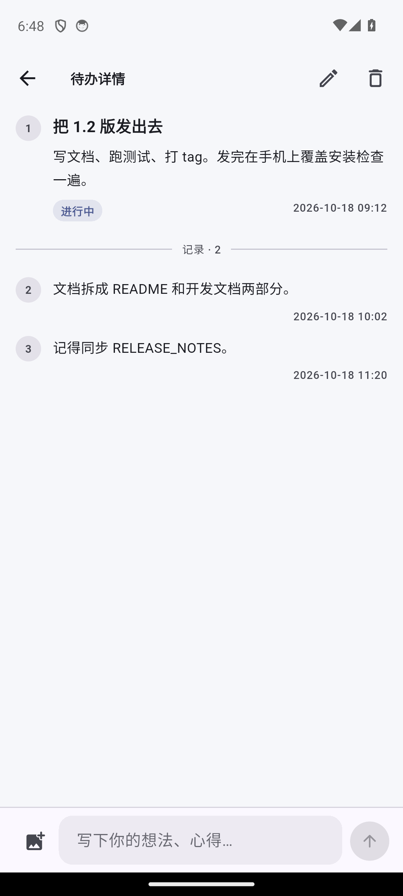

# 拾记

卡片式待办与灵感记录，Android 应用。待办有完成状态，灵感只是记录；
两者都能在详情里逐楼补充想法。所有数据只存在手机本地，没有账号，
联网只用于应用内更新检查。

## 功能

- **两个标签**：首页在「待办」与「灵感」之间切换。待办可以完成，灵感只作记录，
  没有待完成 / 已完成状态。
- **双列瀑布流**：矩形卡片左右两列排布，高度各不相同，互不对齐。
- **卡片内容**：顶部是标题，留空时自动取正文第一句；下面是正文预览。
- **长按 3 秒完成**：卡片上一个环形进度走完即标记完成，松手或滑动会取消。
  完成时手机给出「重击 + 两下轻击」的触感，卡片随之灰化、标题划线，
  右上角留一枚对勾徽标。
- **列表形态**：右上角切到列表，每行前面一个方框，点一下即完成；完成的行会沉到底部，
  误点可以撤销。灵感在列表里显示为灯泡。
- **随时编辑**：详情页右上角可以编辑标题与正文，楼层记录和完成状态保持不变。
- **返回即保存**：新建时写完内容直接返回也算创建，不用担心误触返回丢掉刚写的内容；
  之后想删随时可以从详情页删除。
- **详情像评论区**：第一楼是这条内容本身（标题可空），分割线以下逐楼记录你的想法、
  心得，每条都带精确到分的发表时间。新增记录自动滚到最新一楼。
- **记录能配图**：发记录时可以从相册选一张照片或 GIF，GIF 保留动画；楼层里的图片
  点一下可全屏查看。
- **应用内自动更新**：启动时自动检查 GitHub Releases 上的新版本，首页右上角也能手动
  检查；发现新版本在应用内下载，完成后直接唤起系统安装器。
- **删除只在详情页**：右上角删除，二次确认后连同全部记录一起移除。
- 深色 / 浅色跟随系统。

## 安装

到 [Releases](https://github.com/fenlyin0420/masonry-todo/releases) 按架构下载对应的
APK，在手机上允许「安装未知来源应用」后安装：

- 绝大多数手机（64 位）：`masonry-todo-arm64-v8a.apk`
- 老款 32 位机型：`masonry-todo-armeabi-v7a.apk`

首次安装需要 Android 7.0 及以上。应用启动时会自动检查 GitHub Releases 上的新版本，
有更新会提示下载。

## 开发

架构、数据模型、存储格式、测试与发版流程见 [开发文档](docs/development.md)。
